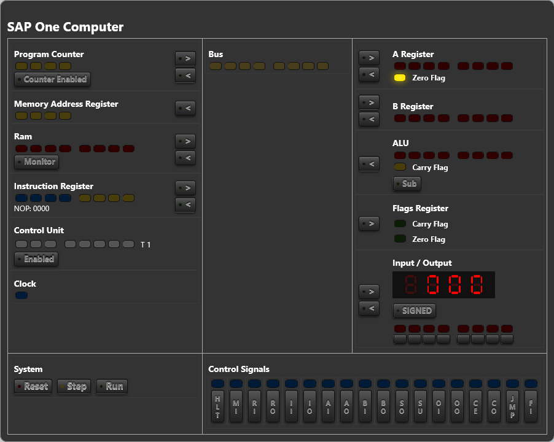

# 🧠 SAP-1 Simulation in React

## Short Description

This project is an **interactive web simulation** of the **SAP-1 (Simple As Possible Computer)**, inspired by **Ben Eater**.  
The goal is to visually and interactively demonstrate the core principles of computer architecture (registers, bus system, control logic, ALU, etc.) directly in the browser using **ReactJS**.

---

## Detailed Description

### 🧩 SAP One Simulator – A Visual Implementation of Ben Eater’s SAP-1 Computer in ReactJS

### Overview

This project is a web application that simulates the **SAP-1 Computer** (“Simple As Possible”), based on the design made famous by **Ben Eater**.  
The SAP-1 is a minimal 8-bit computer that illustrates the fundamental building blocks of a CPU in an easy-to-understand way.

The application allows users to observe the state of all registers, the data flow over the bus, and the execution of each instruction **step by step**.  
Users can enter programs, execute instructions, and watch the clock cycles visually – just like with the real breadboard version.

---

### 🎯 Project Goals

- Help users understand the **basics of computer architecture**
- Provide an **interactive visualization** of registers, bus system, control unit, and ALU
- Simulate the **clock cycle** and microinstructions
- Allow users to load and run their own SAP-1 assembly programs

---

### 🧰 Technologies Used

- ⚛️ **ReactJS** (Frontend)
- 🎨 **CSS** (UI)
- 🧩 **State management** with React Hooks

---

### 🚀 Planned Features

- Visualization of all key registers (**A, B, MAR, IR, PC, OUT**)
- Display of the **data bus** and active control signals
- **Step-by-step** or **automatic clock** execution modes
- **Custom assembly program** input and storage
- **Debug mode** showing current microinstructions

---

### 💡 Motivation

This project is inspired by **Ben Eater’s educational videos** on the SAP-1 computer.  
It aims to let learners explore how a simple computer works **without physical hardware** — directly in the browser, in a visual and intuitive way.

.
